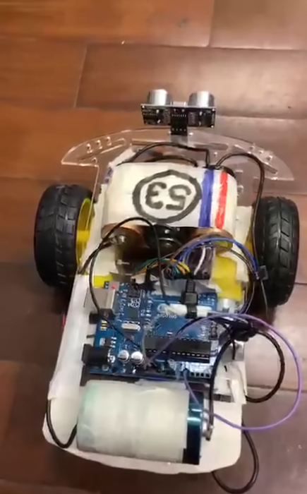

#  Robô Autônomo com Arduino

Projeto de um robô autônomo controlado por Arduino Uno, programado em C++, que usa um sensor ultrassônico para identificar obstáculos.

##  Objetivo
Aprender, na prática, a integração entre hardware e software: leitura de sensores, controle de motores e programação em C++ para Arduino.

##  Funcionalidades
- Anda para frente quando não há obstáculos próximos
- Detecta objetos à frente com o sensor ultrassônico HC-SR04
- Recua ao encontrar um obstáculo a aproximadamente 26 cm ou menos
- Funciona de forma autônoma, sem celular ou controle remoto

> **Observação:** na versão atual, depois de detectar um obstáculo, o robô entra em modo de recuo permanente. Ele ainda não faz curvas nem desvia automaticamente.

##  Tecnologias e componentes
- **Linguagem:** C++ (Arduino IDE / VS Code)
- Arduino Uno
- 2 motores DC com rodas
- Driver de motor L298N
- Sensor ultrassônico HC-SR04
- Bateria para alimentação
- Chassi com estrutura de suporte
- Jumpers e fios

## 📷 Demonstração

## ⚙️ Como usar
1. Monte o circuito com os componentes acima.
2. Abra o arquivo `[nome-do-arquivo].ino` na Arduino IDE.
3. Selecione a placa **Arduino Uno** e a porta correta.
4. Clique em **Upload** e ligue a bateria.

## 🔌 Esquema de ligação
- Sensor HC-SR04: Trig → pino [__], Echo → pino [__]
- Driver L298N: IN1 → [__], IN2 → [__], IN3 → [__], IN4 → [__]
